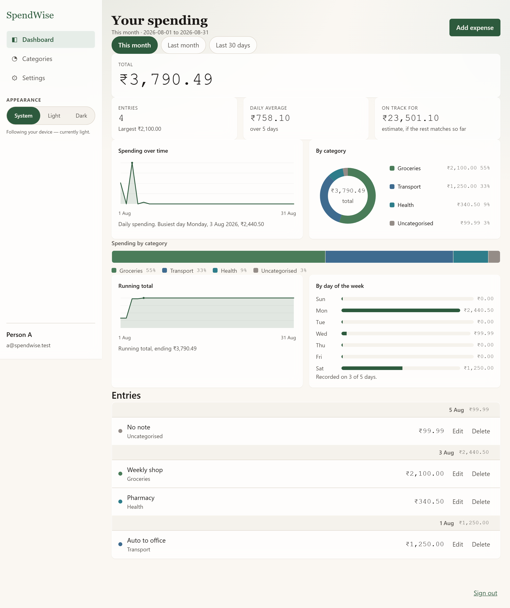
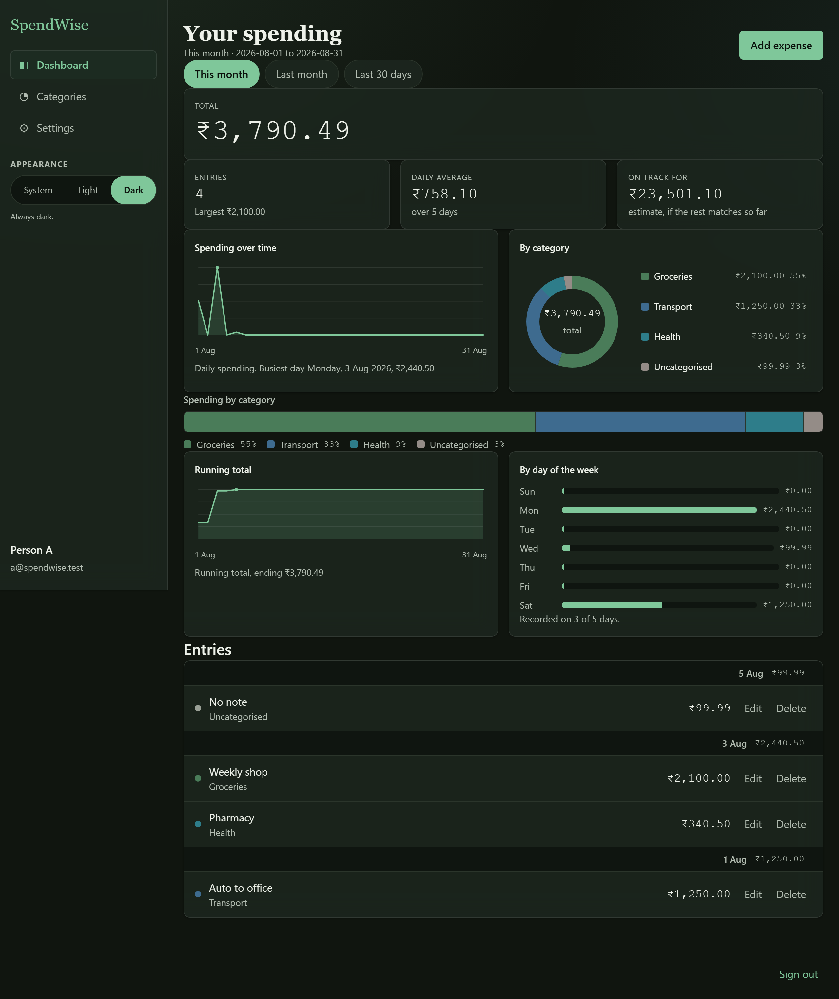

# SpendWise

A personal expense tracker. One deployable — a modular monolith with six
modules and hard internal boundaries — serving both the API and the built
React client from a single origin (`SW-ADR-020`), so there is no CORS and the
session cookie is first-party.

Sign up, log what you spend, see a correct dashboard. A second person cannot
see the first's money, and that is proved at the database layer, not asserted.



A sidebar shell with light/dark/system appearance, a glass surface over a pine
wash, a line plot and a donut that are both **filters as well as charts**,
custom categories, a settings screen, and an administration console that
analyses accounts and activity and **cannot show anyone else's money** — that
last one enforced by a two-column `SECURITY DEFINER` function, not by a
response model.



---

## Running it

### 1. Configuration

Everything lives in `.env`, which is **gitignored and has never been
committed**. Copy the manifest and fill it in:

```
cp .env.example .env
```

The application refuses to start with a missing required key — it exits **78**
naming every one of them, before uvicorn binds the port. That is deliberate
(`E0-S1` AC3): a process that boots and then fails on the first request has
already told a load balancer it is healthy.

### 2. The database

RDS PostgreSQL 18, `ap-south-1`, two databases in the one instance
(`SW-ADR-068`): `spendwise` and `spendwise_test`. Two roles:

| role | what it does |
|---|---|
| `spendwise_owner` | owns every table, runs Alembic, **never serves a request** |
| `spendwise_app` | serves every request, holds no DDL, subject to row-level security |

Migrations run under `MIGRATION_DATABASE_URL`; the application runs under
`DATABASE_URL`, and a boot assertion fails closed if they are the same string.

```
py -m alembic upgrade head
```

### 3. The client

```
cd client
npm install
npm run build
```

`client/dist` is what the API serves. Without it the API still runs and logs
one warning — the backend does not depend on the frontend toolchain.

### 3b. Two accounts to sign in with

```
py tools/reset_and_seed.py
```

**This wipes `spendwise`** and creates one administrator and one person, with
freshly generated passwords printed **once**. The administrator is created
through `BOOTSTRAP_ADMIN_EMAIL` — the real path `SRC-001 §4.4` specifies — so
the `bootstrap_admin_claimed` audit row exists rather than the mechanism being
bypassed with an `UPDATE`.

### 4. Start

**From the repository root** — `client/` is where you were for step 3:

```
cd D:\Project\SpendWise
py -m uvicorn app.main:app --host 0.0.0.0 --port 8000
```

Open <http://localhost:8000>.

(`.env` is found relative to the repository, not the shell's working
directory, so this works from anywhere — but `app.main` still has to be
importable, which means the root.)

For frontend work, `npm run dev` in `client/` proxies `/api` to port 8000, so
the development setup keeps the single-origin shape production has.

---

## Checking it

```
py -m pytest                        # 391 tests, ~6 min against real RDS
py -m pytest -m "not db"            # the pure ones, no network
py -m pytest -m gate                # the never-waivable day-one proof
py -m pytest tests/browser          # 50 Chromium tests against a real server

py tools/consistency_check.py       # every cross-reference in the documents
py tools/consistency_check.py --selftest   # 16/16 checks proved to fire
py tools/contrast.py --check        # every contrast pair, both themes
py client/sync_tokens.py --check    # the client's design tokens have not drifted
cd client && npm run lint:tokens    # no raw hex, one money formatter, one focus rule
```

**The gate** (`CONSTITUTION` Art IX.4) is `daily_average_paise == 75810` over
the seeded day-one fixture. It is computed by application code from rows
PostgreSQL returned under row-level security, read back through the real
endpoint, and — since `GOAL_14` — also read off the screen in a real browser.

It is evaluated as of **2026-08-05** and every runner pins
`APP_TODAY_OVERRIDE` to that date. The divisor is days elapsed, so the value
changes every midnight; `SW-ADR-146` records the day that was found the hard
way.

---

## What is here

| | |
|---|---|
| `app/` | the monolith. `core/` is shared; `modules/{auth,users,expenses,categories,receipts,admin}/` each own their tables |
| `client/` | React 18 + Vite, plain CSS, no UI framework. Tokens are **generated** from the design system |
| `alembic/` | one baseline migration, generated from `docs/06 DataModel/datamodel.json` |
| `tests/` | 391 tests. `tests/browser/` drives Chromium against a real uvicorn |
| `tools/` | `consistency_check.py`, and the scripts that produce evidence |
| `docs/` | 149 decision records, the frozen source, the PRD, the data model, the design system — see `docs/README.md` |

Twelve artifacts are **generated** and verified by regeneration on every run of
`consistency_check.py`: the schema, the policies, the traceability matrix, the
bootstrap script, the baseline migration, the API contract's rendered pages,
the expected summary fixture, `docs/README.md`, the client's design tokens
and `CONTRAST.md`.
Editing one by hand is erased by the next run, silently — so none of them are
edited by hand.

---

## What is not built

Recorded rather than implied by a green suite:

| | |
|---|---|
| **M5 receipts** | needs an S3 bucket that does not exist. `S3_BUCKET` stays unset, `receipts_enabled` reports `false`, the client hides the control, and one WARN names the disabled feature at boot. Designed behaviour — but a gap in coverage |
| **M6 hardening** | rate limits, and the log deny-list red-proof |
| **E0-S10** | the endpoints exist and are tested; the fresh-clone run signed by a named human has not happened |

`docs/10 EngineeringLedger/engineering_ledger.tsv` is the frontier. Anything
not built is `Backlog` or `InProgress` with the reason — never quietly `Done`.
