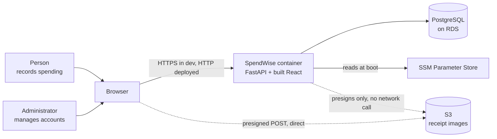

# System context

**What SpendWise talks to:** a Postgres database, an object store for receipt images, and a
parameter store for **three** secrets — the runtime database URL, the migration database
URL, and the signing secret. That is the entire list. Two database ROLES (`SW-ADR-081`) mean
two connection strings; counting them as one is what made this read "two".

**What it deliberately does not talk to:** no email provider · no payment provider · no bank or
Account Aggregator · no analytics · no error-tracking vendor · no AI model at runtime.
Each absence is a ruling, not an oversight — `SRC-001 §12`, `SW-ADR-012`.

**The one non-obvious edge:** the browser uploads receipts **straight to S3**, so the file never
passes through the container. That is a second origin, which is why `SRC-001 §2.4`'s "no CORS to
configure" is wrong for that path and needed erratum `E-8`.
