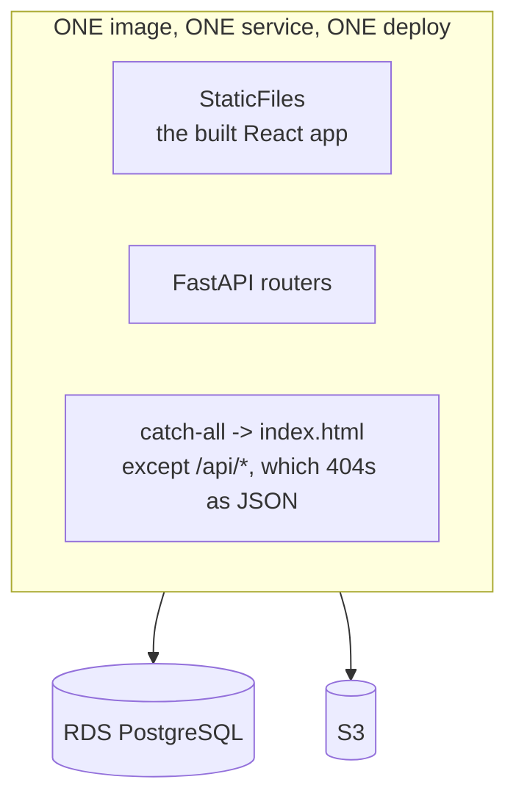

# Container view

**Why one image** (`SRC-001 §2.4`, `SW-ADR-020`): one origin means **no CORS to configure for the
API**, one deploy command, one thing to roll back. The client explicitly refused a separate CDN
distribution for the frontend.

**The trap this creates:** the catch-all serves `index.html` for anything unmatched — so a typo'd
`/api/` path would return **HTML with a 200** to a caller expecting JSON. Unmatched `/api/*` is
therefore excluded from the catch-all and returns a JSON 404 (`SW-ADR-075`).

**Module layout** (`SRC-001 §3`): `auth · users · expenses · categories · receipts · admin`, each
with `router · service · repository · schemas · models`. Routers never write queries; repositories
never know what HTTP is; the service translates.

**A module touches only its own tables.** The one sanctioned crossing: the summary's category
*names*. The expenses repository returns ids and totals; the expenses **service** asks the
categories service for names and stitches. One request for the browser — which is what `§7.4`
actually asked for. It asked for one **request**, not one SQL statement (`SW-ADR-017`).
