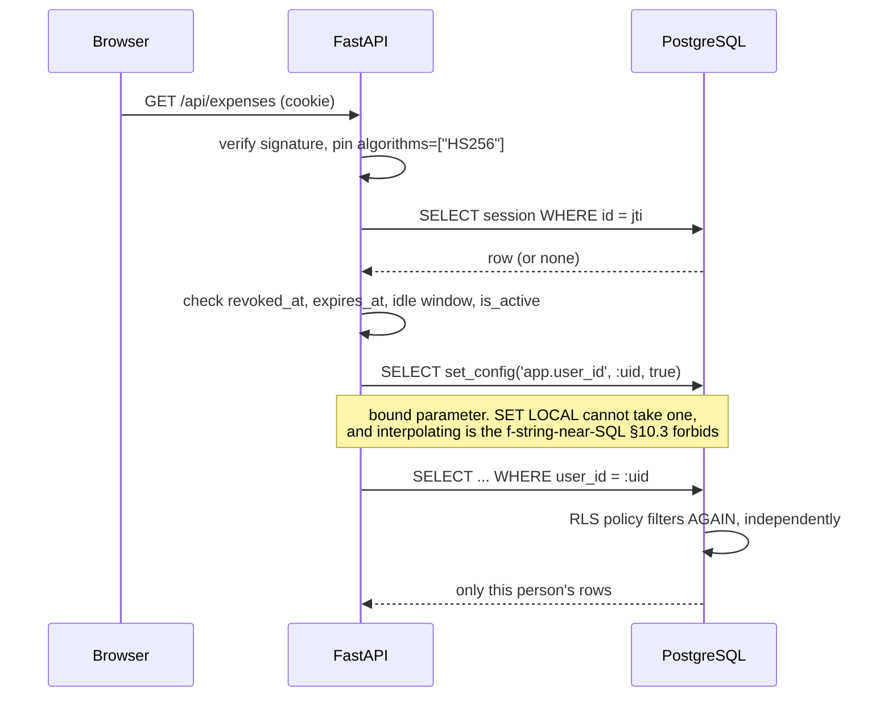

# Security and isolation

## Two layers, and what each catches

**Layer 1** catches nothing on its own — one forgotten `WHERE` and it is gone.
**Layer 2** catches that forgotten `WHERE`. Neither is sufficient; together they are.

## The two roles

| | `spendwise_owner` | `spendwise_app` |
|---|---|---|
| Owns the tables | yes | **no** |
| Superuser | no | **no** |
| `BYPASSRLS` | no | **no** |
| Runs migrations | yes | no |
| Serves traffic | no | yes |

**Asserted against the catalog at boot**, not assumed. Startup aborts if any of the three fails.

## Where the guarantee stops, stated plainly

`users` and `password_resets` sit **outside** row-level security (`SW-ADR-097`, `SW-ADR-071`).
A policy keyed on the request identity cannot serve a lookup that happens *before* there is one —
sign-in reads by email, and code redemption reads by token hash. Both are unauthenticated by
definition. Four compensating controls are MUSTs.

**This is a recorded waiver.** It reduces the `SW-ADR-082` promise and says so.

## Three things that would silently defeat it

| | Why it collapses | Closed by |
|---|---|---|
| One `DATABASE_URL` for migrations and runtime | the runtime connection owns the tables, and an owner can `ALTER TABLE … NO FORCE` | `SW-ADR-081` — two URLs + a boot assertion |
| A `FOR SELECT`-only policy | writes are refused for *everyone* — loud, not silent — but a weak `WITH CHECK` is silent | `SW-ADR-078` — `FOR ALL`, both clauses |
| A foreign key to another person's row | **FK checks always bypass RLS** | `SW-ADR-072` — composite FK |

The third is the one nothing else catches: a cross-person **read**, achieved entirely through a
**write** path.
