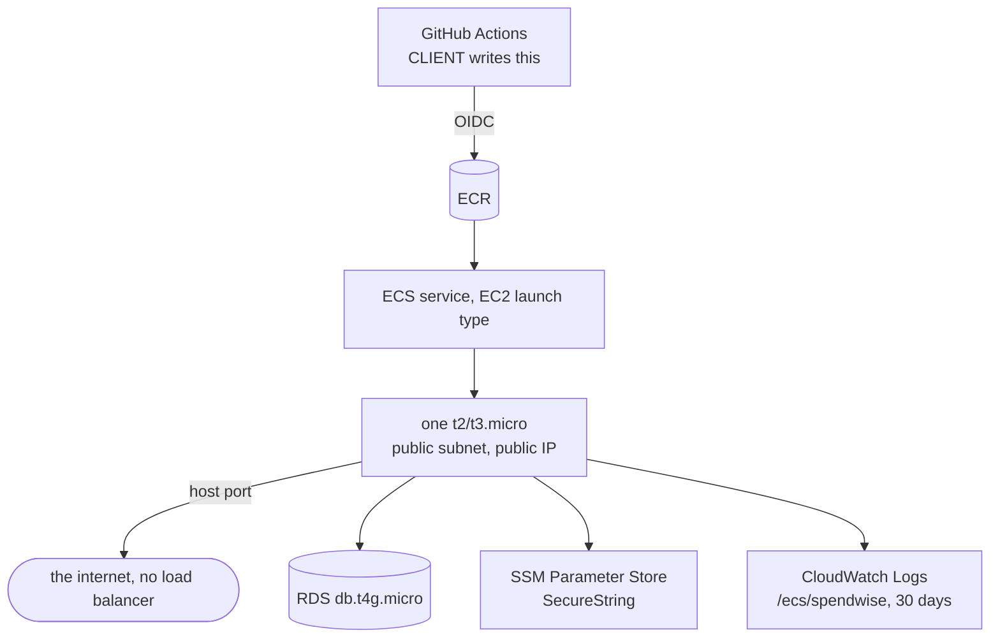

# Deployment

> **UNVERIFIED — reasoned, not observed.** The build session creates nothing in AWS and
> never watches this run (`SW-ADR-005` (superseded by `SW-ADR-155`, 2026-09-13)). Only the client can turn any AWS claim below into
> evidence.

**Everything paid was removed** (`SW-ADR-014`): no Fargate · no load balancer · no NAT gateway ·
no Secrets Manager. Roughly $50/month of components, none of which this project needs.

**What that costs, recorded rather than hidden:**

| | |
|---|---|
| No load balancer | **no TLS** — the session cookie travels in clear. That environment is **never called production in any document.** |
| One instance, one host port | two tasks cannot coexist, so **every deploy is a visible outage.** Deployment min-healthy must be 0 or the first redeploy deadlocks. |
| In-process rate limiting | the effective limit multiplies by worker count and resets on restart. Accepted knowingly. |

**Boot order** (`SW-ADR-093`, `SW-ADR-081`, `SW-ADR-125`):
settings → **catalog assertion** → migrations under `pg_advisory_xact_lock` with
`row_security = off` on that connection only → print current and target revision → compare the
signing-secret fingerprint and revoke every session if it moved → bind the port.

**Two IAM roles, and the distinction matters** (`SRC-001 §11.5`): the **execution** role is used
by ECS *before* the code exists — pulling the image, reading parameters. The **task** role is used
by the code once running — reaching S3. Parameter permissions go on the first; S3 on the second.
