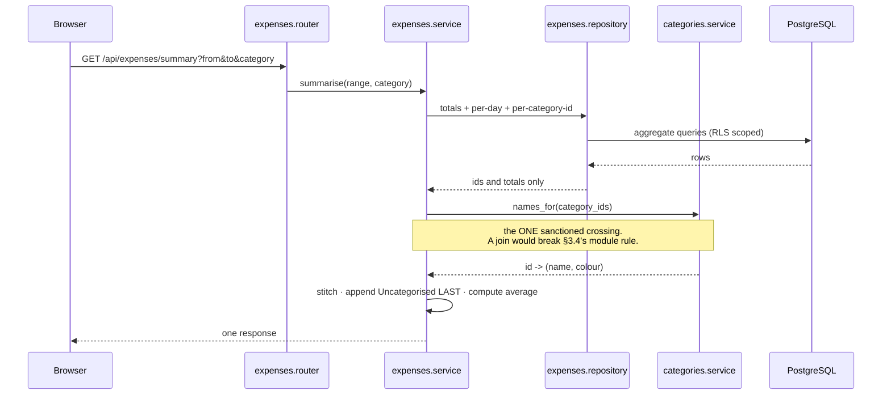

# The dashboard's single round trip



**The average**, computed once, server-side:

```
elapsed = max(0, min(to, today) - from + 1)     # today in Asia/Kolkata
average = round_half_up(total_paise / elapsed)
average = null when elapsed = 0                  # rendered "—", never 0
```

**Invariant, asserted in tests:** the breakdown sums **exactly** to the headline total. Null-category
rows are guaranteed to exist — deleting a category nulls the link on every historical expense — so
if the stitch dropped them, the split would sum to less than the total printed above it.

**Why the browser never recomputes this:** it would be a second implementation of the one rule the
day-one gate checks, and a drift between the two is invisible to that gate (`SW-ADR-058`).
