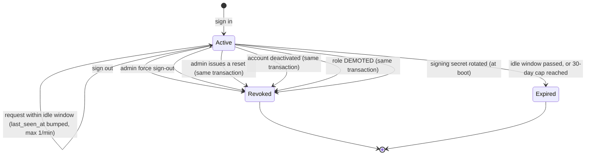
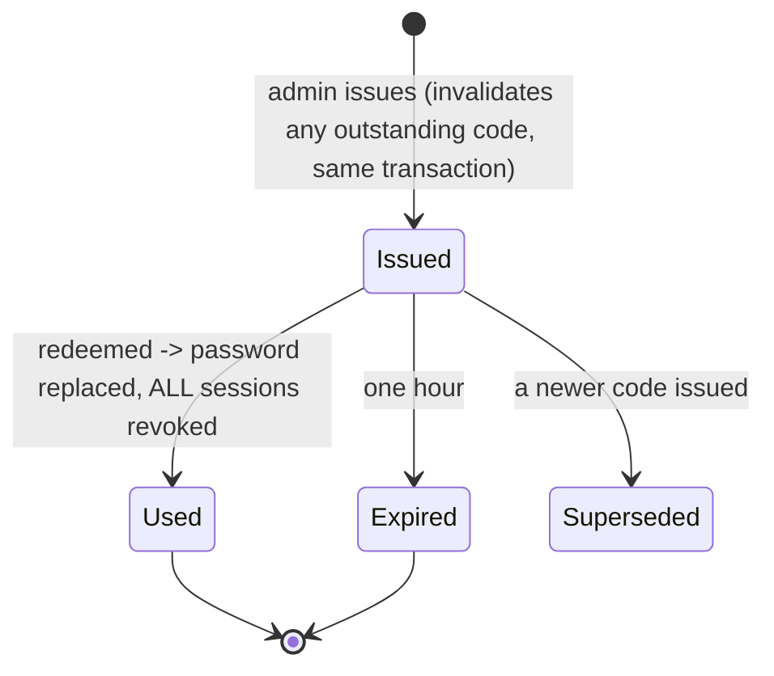

# State machines

## Session

**Reactivation never resurrects a revoked session.** Promotion does *not* revoke — the role is
re-read from the record on every request, so a promotion applies immediately without a logout.

## Reset code

Four **distinguishable** outcomes at redemption: recognised · already used · expired · not
recognised. A used code is spent and an expired one is dead, so telling them apart helps the
legitimate holder and gives an attacker nothing.

## Expense

```mermaid
stateDiagram-v2
    [*] --> Recorded: create
    Recorded --> Recorded: edit (endpoint exists; no screen in v1)
    Recorded --> WithReceipt: attach
    WithReceipt --> WithReceipt: replace (row commits, THEN the old object is deleted)
    WithReceipt --> Recorded: remove receipt
    Recorded --> [*]: delete (confirmed, naming the amount and date)
    WithReceipt --> [*]: delete (confirm also warns the receipt goes)
```

